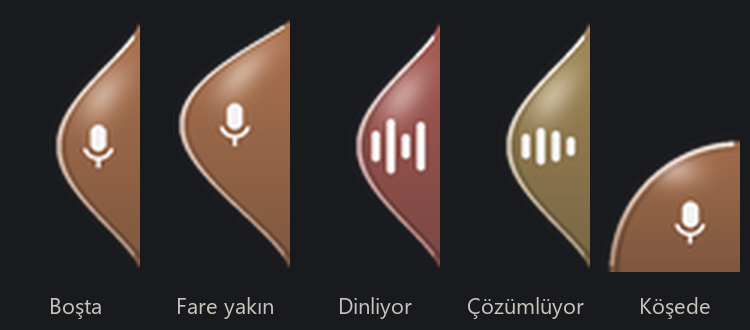

# Sesli Komut — Türkçe sesle yazma (Windows)

Türkçe konuşmayı yazıya çevirip seçtiğin pencereye yazan küçük bir Windows aracı. Claude Code'u terminalde kullanırken sesli giriş olmadığı için yazdım; şimdi her gün kullanıyorum. Terminal, tarayıcı ya da not defteri fark etmez, metin yazılabilen her pencerede çalışır. İstersen Claude'un verdiği cevabı da sesli okur.

Konuşma bilgisayarın kendi ekran kartında, internete çıkmadan yazıya çevrilir ([faster-whisper](https://github.com/SYSTRAN/faster-whisper), `large-v3-turbo`). RTX 4050'de bir cümle yaklaşık **0,4 saniyede** çevriliyor (Google'ın servisi ~2 sn, işlemcide küçük model 1,3-3,7 sn). Ekran kartı yoksa ya da model yüklenemezse Google'ın konuşma tanımasına geçer, o zaman internet gerekir.

*A tiny Windows dictation tool for Turkish: a glassy droplet docked to the screen edge listens on F9, transcribes locally on the GPU with faster-whisper (~0.4 s per sentence on an RTX 4050) and pastes the text into the chosen window. It can also read Claude Code's replies aloud through a Stop hook.*

## Ekran görüntüleri

Ekranın kenarında duran cam damla, duruma göre şekil ve renk değiştiriyor:



## Neler yapıyor

- **Az yer kaplar:** ekranın kenarına ya da köşesine yapışan, cam görünümlü küçük bir damla. Fare yaklaşınca damla ona doğru hafifçe uzar. Sürükleyince en yakın kenara ya da köşeye yapışır ve yerini hatırlar.
- **Konuş, sus, bitti:** F9'a bas ya da damlaya tıkla. Dinlerken damlada sesine göre oynayan çizgiler çıkar. 1,8 saniye susunca kayıt kendiliğinden biter (düşünme duraklamalarında kesmesin diye).
- **Doğru pencereye yazar:** metin panoya alınıp Ctrl+V ile yapıştırılır, Türkçe karakterler bozulmaz. İstersen ardından Enter'a da basar. Odak çalmaz, yazdığın pencere önde kalır.
- **Uydurmaları siler:** Whisper'ın sessizlikte uydurduğu "İzlediğiniz için teşekkür ederim", "Altyazı M.K." gibi kalıplar atılır.
- **Claude'un cevabını sesli okur (isteğe bağlı):** Claude Code bir cevabı bitirince damlanın ucundan küçük bir damlacık kopar. Tıklayınca ya da otomatik okuma açıksa cevap Türkçe sesle okunur (edge-tts, `tr-TR-AhmetNeural`). İlk cümle hemen, kalan kısım arka planda hazırlanır; uzun cevapta bekletmez. Kod blokları ve Markdown işaretleri okunmaz. F9'a basınca okuma susar.
- **Tek kopya:** kısayola tekrar basınca eski kopya kapanır, temiz başlar.

## Kurulum

Windows 10/11 ve Python 3.10 ya da üstü gerekiyor.

```
pip install -r requirements.txt
pythonw sesli_komut.py
```

İlk açılışta Whisper modeli (~1,6 GB) indirilir, sonrasında internet gerekmez. NVIDIA ekran kartın yoksa `nvidia-*` paketlerini kurmayabilirsin, araç Google tanımayla çalışır.

**Claude'un cevabını sesli okuma** için Claude Code ayarlarına (`~/.claude/settings.json`) bir Stop hook'u ekle:

```json
{
  "hooks": {
    "Stop": [{ "hooks": [{ "type": "command", "command": "pythonw C:/yol/sesli-komut/cevap_kaydet.py" }] }]
  }
}
```

## Kullanım

| Ne | Nasıl |
|---|---|
| Konuşmaya başla / bitir | **F9** ya da damlaya tıkla |
| Ayar paneli | **Shift+F9** ya da damlaya sağ tıkla |
| Damlayı taşı | Sürükle, kenara ya da köşeye yapışır |
| Claude'un cevabını dinle | Damlacığa tıkla (ya da panelde "Cevabı sesli oku"yu aç) |
| Kapat | Ayar panelinde **Uygulamadan çık** |

Ayar panelinde metnin yazılacağı pencereyi seçiyorsun (açılışta VS Code seçili gelir) ve otomatik Enter'ı açıp kapatıyorsun. VS Code'da metin en son tıkladığın panele gider; terminale yazmak istiyorsan terminal paneli seçili olmalı.

## Nasıl çalışıyor

- Mikrofon açılışta bir kez dinlenip ortamın gürültü eşiği ölçülüyor. Kayıt bu eşiğe göre başlıyor ve bitiyor.
- Damla Tk ile değil, Pillow'la 4 kat büyük çizilip küçültülüyor ve piksel başına saydamlıkla (`UpdateLayeredWindow`) ekrana basılıyor. Kenarları bu yüzden yumuşak ve içi yarı saydam.
- Cevap damlacığı damlanın o anki (fareye uzamış) şekline oturacak biçimde mesafe alanı (SDF) ile yumuşak birleşimle çiziliyor.
- `cevap_kaydet.py` Claude Code'un Stop hook'u: son cevabı `son_cevap.txt`'ye yazar, araç dosyayı içerikten takip eder. Ses çalma Windows MCI ile, ek paket yok.

```
sesli_komut.py     uygulamanın tamamı: damla, dinleme, Whisper, yapıştırma, sesli okuma
cevap_kaydet.py    Claude Code Stop hook'u (son cevabı dosyaya yazar)
requirements.txt   bağımlılıklar
```
